<div align="center">



</div>

### `> whoami`

```text
name       : Aymane Aboulhouda
role       : AI & Big Data engineering student
school     : UIR (Rabat) x Université de Sherbrooke
degree     : M.Sc. Computer Science, AI & Data Science (double diploma)
location   : Sherbrooke, QC
focus      : distributed pipelines / streaming detection / computer vision / applied GenAI
ethos      : reproducible, measured, self-hosted, local-first
```

### `> ls ~/stack`

```text
languages  : python  c++  typescript  javascript  bash
data       : spark  hive  hdfs  kafka
ml / cv    : opencv  numpy  gradient-boosted-trees  pybind11
web        : react  node.js  astro  tailwind
infra      : docker  linux  git  pi-hole  portainer
```

### `> cat ~/projects.log`

| project | description | stack |
|:--|:--|:--|
| [`distributed-energy-forecasting`](https://github.com/AymaneJoestar/distributed-energy-forecasting) | smart-grid energy forecasting on a distributed pipeline | `spark` `hive` `hdfs` `gbt` |
| [`License-Plate-Deblurring`](https://github.com/AymaneJoestar/License-Plate-Deblurring-ComputerVision-) | restores motion-blurred plates for recognition | `python` `opencv` |
| [`aymane_tp`](https://github.com/AymaneJoestar/aymane_tp) | cumulative-median extension, C++ core exposed to Python | `c++` `pybind11` `numpy` |
| `lyricflow` `[private -> public soon]` | full-stack AI lyric + music generation | `react` `node` `suno` `gemini` `sdxl` |
| `network-ids` `[private -> public soon]` | real-time network intrusion detection | `kafka` `spark` |

### `> stats --live`

<div align="center">


</div>

### `> contact`

```text
linkedin   : https://www.linkedin.com/in/YOUR-HANDLE
email      : YOUR-EMAIL
```

<div align="center">

```text
░▒▓█▓▒░  end of transmission  ░▒▓█▓▒░
```

</div>
