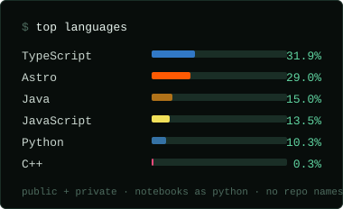

<div align="center">


</div>

### `> whoami`

```text
name       : Aymane Aboulhouda
role       : AI & Big Data engineering student
school     : UIR (Rabat) x Université de Sherbrooke
degree     : M.Sc. Computer Science, AI & Data Science (double diploma)
location   : Sherbrooke, QC
focus      : distributed pipelines / streaming detection / computer vision / applied GenAI
ethos      : reproducible, measured, self-hosted, local-first
```

### `> ls ~/stack`

```text
languages  : python  c++  typescript  javascript  bash
data       : spark  hive  hdfs  kafka
ml / cv    : opencv  numpy  gradient-boosted-trees  pybind11
web        : react  node.js  astro  tailwind
infra      : docker  linux  git  pi-hole  portainer
```

### `> ls ~/projects`

#### `ocp-intervention-app` &nbsp;`private` &nbsp;`internship · OCP Group`
Maintenance intervention platform built during my engineering internship at OCP's Khouribga site. Technicians log interventions, and an ML service predicts their urgency live as the request is typed.
```text
frontend   react + vite  ·  dashboard KPIs, filtered pagination, status workflow, geocoded sites
backend    node.js / express  ·  postgresql 15 (11 tables, triggers for stock integrity)
ml         fastapi service  ·  tf-idf + linearsvc urgency classifier, predictions stored apart from
           the final label so the model can be evaluated in production
ops        docker compose (4 services)
```

#### `network-intrusion-detection` &nbsp;`private`
Real-time intrusion detection over streaming network traffic: events flow through Kafka and are scored by Spark as they arrive.
```text
stack      apache kafka  ·  apache spark (streaming)
```

#### [`distributed-energy-forecasting`](https://github.com/AymaneJoestar/distributed-energy-forecasting)
Big data pipeline for smart-grid energy forecasting: raw readings land in HDFS, are modeled in Hive, and feed a distributed gradient-boosted-trees regressor in Spark.
```text
stack      hdfs  ·  hive  ·  spark mllib (gbt)
```

#### [`License-Plate-Deblurring-ComputerVision-`](https://github.com/AymaneJoestar/License-Plate-Deblurring-ComputerVision-)
Restores motion-blurred license plates so they can be read by OCR. Estimates the blur kernel (angle and length, via cepstrum / Radon analysis), deconvolves with Wiener and Richardson–Lucy, and scores the result with PSNR, SSIM and Tesseract OCR accuracy on synthetic benchmarks.
```text
stack      python  ·  opencv  ·  scikit-image  ·  scipy  ·  tesseract
```

#### [`aymane_tp`](https://github.com/AymaneJoestar/aymane_tp)
Cumulative median of a stream in O(n log n): a C++ core keeps a sorted set and a moving pointer to the middle element, exposed to Python as a pip-installable module with pybind11, tests and Sphinx docs.
```text
stack      c++  ·  pybind11  ·  numpy  ·  pytest  ·  sphinx / read the docs
```

#### `lyricflow` &nbsp;`private`
Full-stack app that writes lyrics, generates the matching song and its cover art from a single prompt, chaining three generative models.
```text
stack      react  ·  node.js  ·  gemini (lyrics)  ·  suno (music)  ·  stable diffusion xl (cover art)
```

### `> stats`

<div align="center">

&nbsp;

</div>

### `> contact`

```text
linkedin   : https://www.linkedin.com/in/YOUR-HANDLE
email      : YOUR-EMAIL
```
