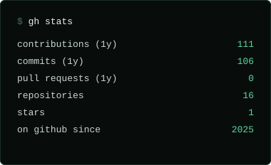

<div align="center">


</div>

### `> whoami`

```text
name       : Aymane Aboulhouda
role       : AI & Big Data engineering student
school     : UIR (Rabat) x Université de Sherbrooke
degree     : M.Sc. Computer Science, AI & Data Science / AI and Big Data Engineer(double diploma)
location   : Sherbrooke, QC
focus      : distributed pipelines / streaming detection / computer vision / applied GenAI
ethos      : reproducible, measured, self-hosted, local-first
```

### `> ls ~/stack`

```text
languages  : python  c++  typescript  javascript  bash
data       : spark  hive  hdfs  kafka
ml / cv    : opencv  numpy  gradient-boosted-trees  pybind11
web        : react  node.js  astro  tailwind
infra      : docker  linux  git  pi-hole  portainer
```

### `> ls ~/projects`

Private repositories are available on request: email aymane.aboulhouda@usherbrooke.ca.

#### `ocp-intervention-app` &nbsp;`private` &nbsp;`internship · OCP Group`
Industrial maintenance platform with an ML urgency classifier, built as a 4-service containerized system during my engineering internship at OCP (Khouribga).
```text
 react/vite spa :3000 ──REST──▶ express api :5000 ──SQL──▶ postgresql 15
                                      │
                                      └──HTTP /predict──▶ fastapi ml service :8000
                                                          tf-idf + linearsvc (joblib)

 data      11-table relational schema · triggers enforce stock integrity and log every
           part transaction · auto updated_at · indexes on hot query paths · soft deletes
 ml        live urgency prediction while the technician types (debounced preview endpoint);
           predicted_urgency stored apart from the final label, so model drift can be
           measured against human decisions in production
 api       layered express routing · status state machine with automatic timestamps ·
           geocoding of sites via nominatim
 ops       docker compose orchestration · persistent volumes · service dependency ordering
```

#### [`lyricflow`](https://lyricflow-music.vercel.app) &nbsp;`live demo` &nbsp;`private`
AI songwriting studio: generates structured lyrics from a topic, a mood or songs you like, then cover art and a full audio track. Songs can be shared to a community feed with ratings and threaded comments.
```text
 react spa ──▶ express api ──▶ mongodb (mongoose)
                    │
                    ├──▶ lyrics provider module  (llm)
                    ├──▶ image provider module   (image generation)
                    └──▶ audio provider module   (task id returned, client polls)

 stack     react 19 · typescript · vite · tailwind · node.js · express 5 · mongodb atlas
 deploy    vercel (static frontend + serverless api)

 providers lyrics, image and audio generation sit behind small swappable server-side
           modules configured through environment variables, so changing a model or
           vendor is a config change
 security  no secrets in the browser: every ai call goes through the backend, which
           rate-limits it, and requires auth for the costly ones (image, audio) ·
           jwt auth · bcrypt with transparent migration of legacy accounts ·
           nosql-injection sanitizing · input validation · rate limits on auth and
           generation endpoints · server-owned identity and quotas
 audio     generation takes minutes: the api returns a task id and the client polls
 accounts  guest mode · password reset by email with single-use hashed expiring tokens ·
           per-tier quotas · stripe checkout with server-side payment verification (demo/test mode)
 quality   vitest + supertest · github actions ci (typecheck, tests, build)
 frontend  custom "record label" design system with vinyl and sleeve motion

 live      https://lyricflow-music.vercel.app (no account needed to try the lyrics)
```

#### `entretien-ai` &nbsp;`private`
Real-time voice interview simulator: a live, low-latency spoken conversation with an AI interviewer (CS, AI/ML, medicine), followed by a structured performance review.
```text
 mic ──getUserMedia──▶ web audio (script processor) ──▶ float32 → int16 pcm 16 kHz → base64
                                                              │
                                              websocket session (realtime speech-to-speech llm api)
                                                              │
 speakers ◀── 24 kHz pcm playback ◀── streamed audio turns ◀──┘ + live input/output transcription

 media      webcam + mic capture with MediaRecorder (webm) for session recording
 eval       transcript → post-interview scoring, structured JSON enforced by response schema
 stack      react · typescript · web audio api · realtime bidirectional audio llm
```

#### `foodscanner` &nbsp;`private` &nbsp;`azure · serverless`
Cloud-native meal tracker: photograph a dish, get it recognized and its nutrition logged, on a fully serverless Azure backend.
```text
 static web frontend ──HTTP──▶ azure functions (node)
 (azure storage $web)            ├─ uploadImage ──▶ blob storage
                                 ├─ analyzeFood ──▶ custom vision classifier ──▶ top prediction
                                 │                   + nutrition lookup (calories, protein, …)
                                 └─ saveMeal ────▶ cosmos db (partitioned by user) · meal history

 api        http-triggered functions · cors · GET/POST routing per function
 ops        infra + deploy scripted with azure cli / functions core tools
```

#### `toxic-comment-classification` &nbsp;`private` &nbsp;`team · nlp`
Multi-label toxicity detection on the Jigsaw Wikipedia comments dataset (6 labels: toxic, severe toxic, obscene, threat, insult, identity hate), benchmarking classical models against a fine-tuned transformer.
```text
 raw comments ──▶ cleaning + EDA ──▶ train/test split ─┬─▶ tf-idf ──▶ logistic regression
                   labels per comment                   ├─▶ tf-idf ──▶ linear svm
                                                        └─▶ tokenizer ──▶ fine-tuned bert
                                                                         (pytorch dataset / dataloader)

 eval       f1 + accuracy · hyperparameter sweeps visualized as heatmaps
           · sanity checks on unseen real-world comments
```

#### `network-intrusion-detection` &nbsp;`private`
Real-time intrusion detection on live network traffic using a distributed streaming pipeline.
```text
 traffic events ──▶ kafka topics ──▶ spark streaming job ──▶ detections / alerts
```

#### [`distributed-energy-forecasting`](https://github.com/AymaneJoestar/distributed-energy-forecasting)
Distributed big data pipeline for smart-grid consumption forecasting.
```text
 raw meter data ──▶ hdfs (storage) ──▶ hive (warehouse / sql modeling) ──▶ spark mllib
                                                                   gradient-boosted trees
```

#### [`License-Plate-Deblurring-ComputerVision-`](https://github.com/AymaneJoestar/License-Plate-Deblurring-ComputerVision-)
Classical image-restoration pipeline that recovers motion-blurred plates and proves it with metrics.
```text
 blurred plate ──▶ blur estimation ──▶ deconvolution ──▶ evaluation
                   psf angle + length    wiener filter     psnr · ssim
                   (cepstrum / radon)    richardson–lucy   tesseract ocr accuracy

 benchmark  synthetic ground-truth plates with known blur → automated comparison table
 tooling    object-oriented pipeline class · interactive parameter widgets
```

#### [`aymane_tp`](https://github.com/AymaneJoestar/aymane_tp)
Native C++ extension for Python: streaming cumulative median in O(n log n).
```text
 c++ core  ordered set + iterator pinned to the median, rebalanced on each insert
 binding   pybind11 → numpy-compatible python module, pip-installable (setuptools / pyproject)
 quality   pytest suite · sphinx documentation published on read the docs
```

#### `bladi-assurance` &nbsp;`hackathon prototype`
Parametric crop-insurance concept for smallholder farmers: a rule-based risk engine scores drought exposure from NDVI and rainfall thresholds, plus a USSD menu simulator for access from basic feature phones.
```text
 stack      react · typescript · vite · recharts
```

### `> stats`

<div align="center">

&nbsp;

</div>

### `> contact`

```text
github     : https://github.com/AymaneJoestar
linkedin   : https://www.linkedin.com/in/aymane-aboulhouda
email      : aymane.aboulhouda@usherbrooke.ca
```
